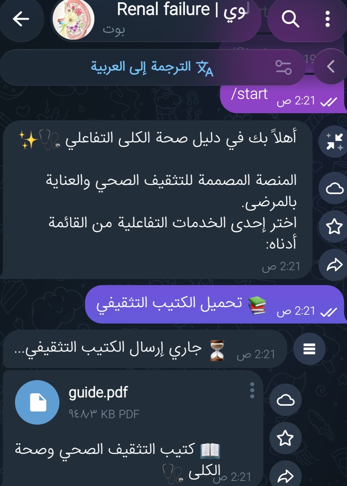
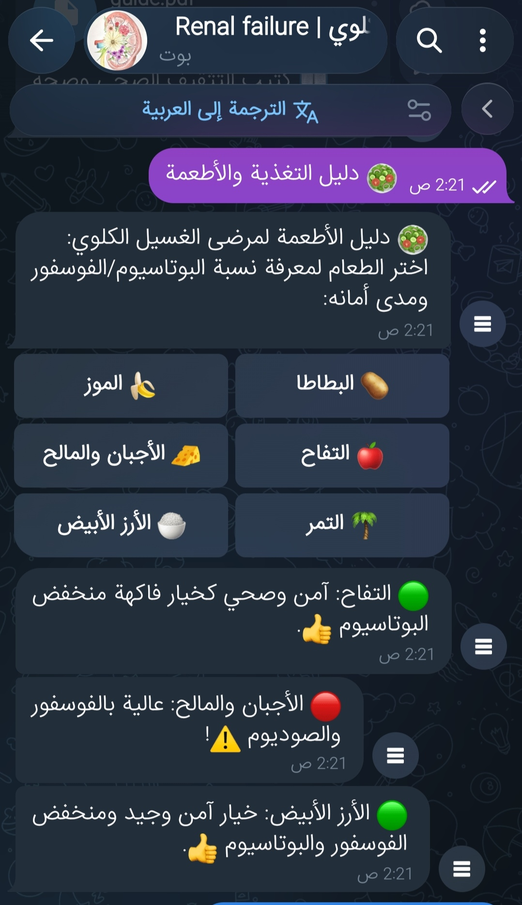
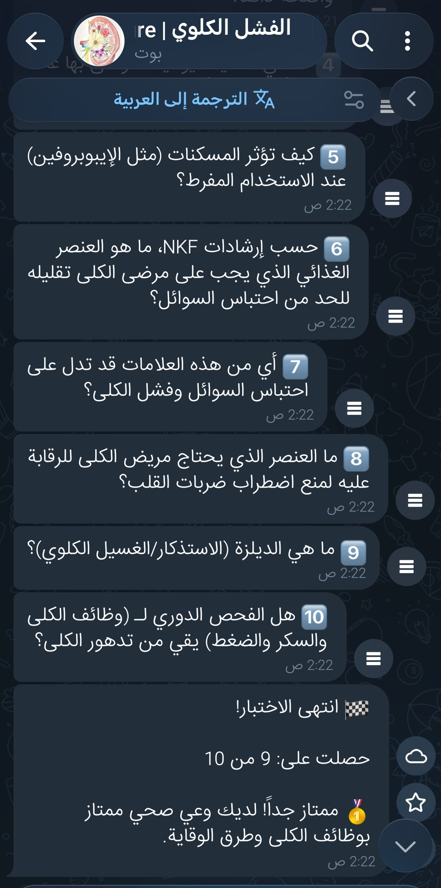
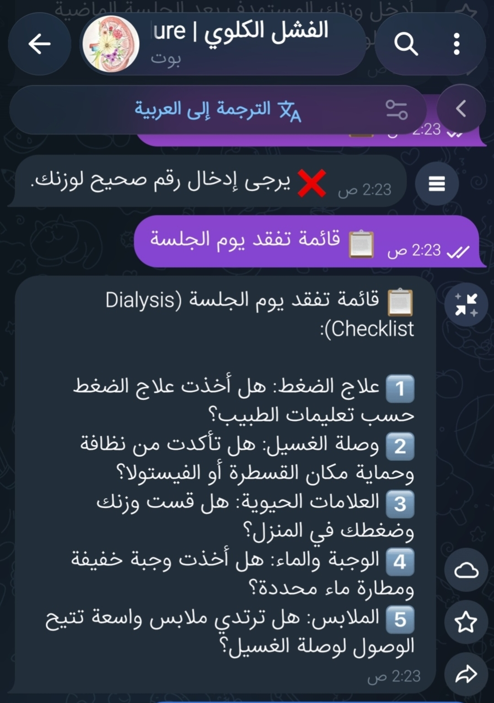

# KIDNEYFABOT — Kidney Health Education Telegram Bot

KIDNEYFABOT is a student-built Telegram bot created as part of a kidney health awareness project.

The project started with an Arabic educational booklet titled **"الفشل الكلوي والديلزة"**. The bot was created to make some of the booklet's educational content more interactive.

## Project Idea

The aim of this project is to present basic kidney health and dialysis-related educational information through a simple Telegram interface.

This is a learning project exploring how technology can be used to present health information in a more interactive way.

## Features

- Main menu with interactive buttons
- Kidney health educational information
- Educational food information
- Simple weight-difference calculation
- Dialysis session checklist
- True/False quiz with 10 questions
- Quiz score
- Google Calendar link for scheduling dialysis sessions
- Access to the accompanying educational booklet

## Screenshots

### Main Menu


### Kidney Health Information



### Educational Food Information



### Interactive Quiz



### Dialysis Session Checklist



## Technology

- Python
- Telegram Bot API
- pyTelegramBotAPI
- python-dotenv

## How the Project Was Developed

I designed the project idea, selected and organized the educational content, created the Arabic booklet "الفشل الكلوي والديلزة", planned the bot features and user flow, and prepared the visual content.

The Python implementation was created with the assistance of AI tools. I used AI-assisted coding to implement the bot and worked on testing and organizing the resulting code.

## Project Structure

```text
KIDNEYFABOT-Telegram-Bot/
├── renal.py
├── requirements.txt
├── README.md
├── .gitignore
├── guide.pdf
├── main_menu.jpg
├── health_information.jpg
├── quiz.jpg
└── checklist.jpg
```

## Educational Scope

This bot is an educational prototype. It is not intended to:

- Diagnose medical conditions
- Provide individualized treatment
- Replace medical advice
- Make clinical decisions

The information provided by the bot is for general educational purposes. Users should consult qualified healthcare professionals for personal medical or dietary advice.

## Privacy

The bot does not intentionally maintain a database of users' medical records.

Some information used during an interaction may be temporarily held in memory while the bot is running.

Users should avoid entering sensitive personal or medical information.

## Limitations

This is a student learning project, not a production healthcare application.

The current version does not include:

- Patient accounts
- A persistent database
- Patient monitoring
- Clinical decision support
- AI or machine-learning features

## What I Learned

Through this project, I explored:

- Basic Python programming
- Telegram bot development
- Message handlers
- Interactive buttons and callback queries
- Multi-step user interactions
- Temporary state management
- Environment variables
- Basic testing and debugging
- Designing an interactive educational user flow

## Related Booklet

The bot is connected to my Arabic kidney health awareness booklet:

**[Kidney Health Awareness Booklet — الفشل الكلوي والديلزة](https://drive.google.com/file/d/1Zy2a8lIxVHfJxo3_FdH4fj0lARHPmLrY/view?usp=drivesdk)**

The booklet and the Telegram bot are two parts of the same project:

**Educational Booklet → Interactive Telegram Bot**

## Disclaimer

KIDNEYFABOT is an educational project and does not provide medical diagnosis, treatment, or personalized medical advice.
